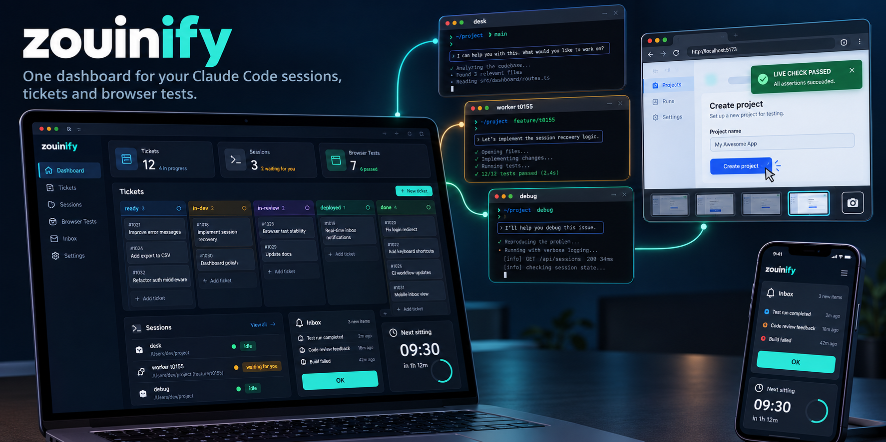
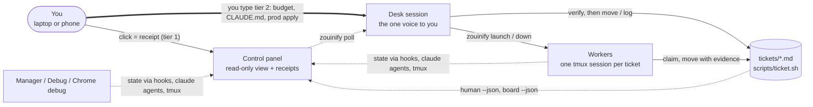

<h1 align="center">zouinify</h1>
<p align="center"><b>One dashboard for your Claude Code sessions, tickets and browser checks.</b></p>

<p align="center">
  
</p>

You run several Claude Code sessions in tmux: a ticket desk, a manager, a debugger, one worker per ticket. zouinify gives them
one ticket lifecycle, launches them the same way every time, and shows you on one page what needs you, which session is
waiting, and what the tickets are doing. It is a Claude Code skill (`/zouinify ...`) and a plain CLI (`zouinify ...`).

> Status: week 1. The CLI works (`config`, `up`, `launch`, `status`, `down`, `briefs`). The web panel is being built.
> This repository holds the skill and generic templates only; your project's names and config live in your own repo.

## What you get

- **One lifecycle.** `backlog → ready → in-dev → in-review → ready-to-merge → merged → ready-to-deploy → deployed → done`,
  enforced by one shell script, with evidence required at every step.
- **Sessions launched right, every time.** Model, name, permission mode, brief and identity come from one config file; running
  `up` twice never opens a second copy.
- **One page for the human.** The inbox of things only you can do, the board, every session with its state, panes waiting for
  you, the apply and deploy logs.
- **Answer a worker from your phone.** A separate, passphrase-locked terminal page types into a worker's pane for you; the
  desk and the other role windows are never reachable from it.
- **Safe by construction.** The panel never types into a Claude session and never deploys anything. A click is a receipt the
  desk session fetches with `zouinify poll` and verifies before anything moves; approvals and production actions stay typed by
  you. The worst a stolen browser token can do is a false tier-1 claim the desk re-verifies, or read the board.

## Quick start

```bash
git clone https://github.com/mzouink/zouinify ~/src/zouinify
ln -s ~/src/zouinify ~/.claude/skills/zouinify             # /zouinify inside Claude Code
ln -s ~/src/zouinify/bin/zouinify ~/.local/bin/zouinify    # zouinify from a shell
```

Then, inside your project:

```bash
zouinify init                  # asks for name, short tag, branches, model, port, your name; writes .ops/config.yaml,
                               # .ops/briefs/*.md and the .ops/state/ line in .gitignore; never overwrites, nothing outside the repo
zouinify init --protocol       # shows the plan, then after your typed yes: scripts/ticket.sh (the vendored core), tickets/ticket.env,
                               # tickets/plugins/none, the rendered tickets/README.md, _TEMPLATE.md, WORKER_BRIEF.md; it prints the
                               # CLAUDE.md block for you to paste (init never writes CLAUDE.md); you commit (init commits nothing)
zouinify config --check        # validates the file (edit it first: repos, human_only, budget)
zouinify up --dry-run          # shows the exact tmux + claude lines it would run
zouinify up                    # starts the desk, manager and debug sessions
```

`zouinify init --dry-run` prints the plan and the config without writing; `--non-interactive --name N --short S --human H`
answers the questions from flags (for a session, which has no terminal). `init --protocol` never runs from a session or without
a terminal (`--dry-run` shows its plan anywhere); the ticket core it installs is a byte-identical, pinned copy of the upstream
script (`templates/protocol/MANIFEST`). Without `init`: copy `templates/ops/config.yaml.example` to `.ops/config.yaml` and run
`zouinify briefs render`. The rendered briefs are generated artefacts: edit `templates/briefs/*.md.tmpl` for what every project
needs or `.ops/briefs.project/<role>.md` for what only your project knows, then render; a changed template, notes or config
renders straight through (each brief carries the digest of its body in its header), a hand-edited brief is refused, and
`--force` is for that case only, after the edit is folded back into one of those two. Needs Python 3.9+ with PyYAML, tmux
3.2+, git 2.31+, bash 4+ and the `claude` CLI on PATH.

## How it fits together



Solid arrows are actions, dotted arrows are read-only data. The bold arrow is the only channel with full authority: you,
typing in the desk's window.

## Learn more

| Document | What it covers |
|---|---|
| [`docs/REFERENCE.md`](docs/REFERENCE.md) | Every command and flag, the session-launch rules, the receipts and security model, the repository layout and the CI guards |
| [`docs/UX_SPEC.md`](docs/UX_SPEC.md) | The panel's look and behaviour: screens, tiers of clickable actions, responsive layout, acceptance criteria |
| [`SKILL.md`](SKILL.md) | What `/zouinify` does inside Claude Code and the rules it never bends |
| [`templates/ops/config.yaml.example`](templates/ops/config.yaml.example) | The per-project config, commented |

## Roadmap

1. **Week 1:** CLI core (done), read-only panel, the first project's config.
2. **Week 2:** receipts channel (browser token, audit, rate limit, `zouinify poll`), hooks, optional intranet access (done).
3. **Week 3:** launch and kill from the panel via the desk, `zouinify init` for a fresh repo (done: config + briefs, then `--protocol` for the vendored ticket core), a home page listing your projects.

Inspired by [lavish-axi](https://github.com/kunchenguid/lavish-axi): a local page, a long-polling agent, nothing in the cloud.
